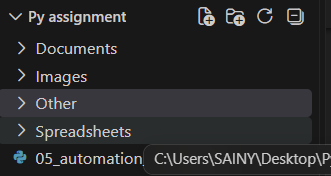
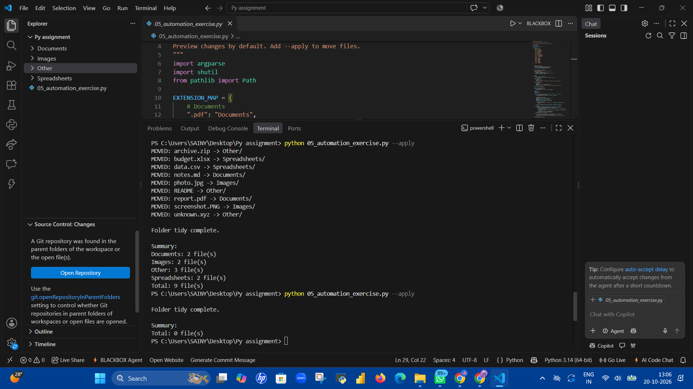

# Python File Organization Automation

A beginner-friendly Python project that automatically organizes files into categorized folders based on their file extensions.

## Overview

Managing files in an unorganized directory can be time-consuming. This project automates the process by sorting files into folders such as Documents, Spreadsheets, Images, and Other.

## Features

- Categorizes files based on their extensions.
- Creates destination folders automatically.
- Supports a dry-run mode to preview changes before moving files.
- Displays a summary of files organized by category.
- Handles unknown extensions and files without extensions.
- Prevents overwriting files that already exist at the destination.
- Supports adding new file extensions through a dictionary.

## Technologies Used

- Python
- `pathlib`
- `shutil`
- `argparse`

## Project Structure

```text
python-file-organization-automation/
├── 05_automation_exercise.py
└── README.md
```

## How to Run

### 1. Clone the repository

```bash
git clone https://github.com/Sainy-Mishra/Python-File-Organization-Automation.git
```

### 2. Navigate to the project directory

```bash
cd python-file-organization-automation
```

### 3. Preview file movements

```bash
python 05_automation_exercise.py
```

The script runs in dry-run mode by default and previews the proposed file movements without moving files.

### 4. Organize the files

```bash
python 05_automation_exercise.py --apply
```

This creates the required category folders and moves the files.

## Example Categories

| File Type | Destination |
|---|---|
| `.pdf`, `.docx`, `.txt`, `.md` | Documents |
| `.csv`, `.xls`, `.xlsx` | Spreadsheets |
| `.png`, `.jpg`, `.jpeg` | Images |
| Unknown extensions and files without extensions | Other |

## Screenshots

### 1. Organized Folder Structure

The final folder structure after running the file organization automation script.



### 2. Terminal Execution Summary

The terminal output showing file categorization and the summary of files processed.



## What I Learned

- Working with Python dictionaries and functions.
- Extracting and handling file extensions.
- Using loops and conditional logic.
- Automating file-management tasks.
- Implementing safe dry-run behavior.
- Handling existing destination files without overwriting them.

## Future Improvements

- Add more file categories and extensions.
- Add logging to track file movements.
- Allow users to configure custom categories.
- Add automated tests for file categorization.

## License

This project is available for learning and educational purposes.
